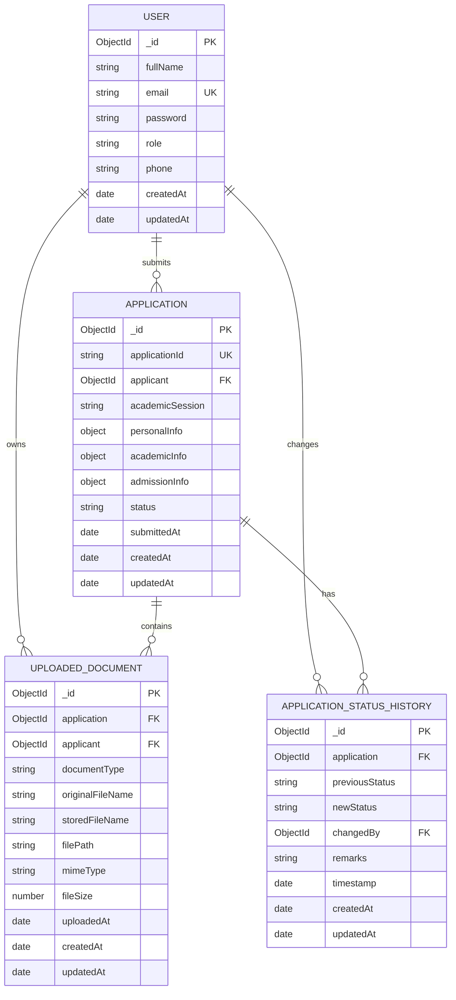

# Database Schema

MongoDB database: `iem_admission_db`  
ODM: Mongoose 8.x  
Models: `User`, `Application`, `UploadedDocument`, `ApplicationStatusHistory`

## Entity-relationship overview



## 1. User schema

Collection: `users`  
Model: `backend/models/user.model.js`

| Field | Type | Required | Constraints and behaviour |
| --- | --- | --- | --- |
| `_id` | ObjectId | automatic | Primary key |
| `fullName` | String | yes | Trimmed; 2–100 characters |
| `email` | String | yes | Trimmed, lowercased, valid email regex, unique |
| `password` | String | yes | Minimum 6 characters; stored as a bcrypt hash; `select: false` |
| `role` | String | no explicit `required`; default applied | Enum `applicant`, `admin`; defaults to `applicant` |
| `phone` | String | no | Trimmed; default `''` |
| `createdAt` | Date | automatic | Mongoose timestamp |
| `updatedAt` | Date | automatic | Mongoose timestamp |

### Password handling

- A `pre('save')` hook hashes the password with bcryptjs (`genSalt(10)`) only when the field is
  modified.
- `comparePassword(candidate)` uses `bcrypt.compare`.
- `password` has `select: false`, so it is not returned by normal queries.
- `toJSON` and `toObject` transforms delete the password field.
- Authentication explicitly selects `+password` only when verifying login credentials.

### Indexes

- `email` unique index.
- Default `_id` index.

### Role rules

- Public registration always stores `applicant`; the validator overwrites any client-supplied role.
- Only the seed script or a direct database operation can create an `admin`.

## 2. Application schema

Collection: `applications`  
Model: `backend/models/application.model.js`

| Field | Type | Required | Constraints and behaviour |
| --- | --- | --- | --- |
| `_id` | ObjectId | automatic | Primary key |
| `applicationId` | String | yes | Unique, indexed, trimmed; generated by the server in `IEM-YYYY-XXXXX` form |
| `applicant` | ObjectId → User | yes | Indexed reference to the owning applicant |
| `academicSession` | String | yes | Default `2026-2027`; trimmed |
| `personalInfo` | Embedded object | yes | See below |
| `academicInfo` | Embedded object | yes | See below |
| `admissionInfo` | Embedded object | yes | See below |
| `status` | String | no explicit `required`; default applied | Enum `Submitted`, `Under Review`, `Selected`, `Rejected`; defaults to `Submitted`; indexed |
| `submittedAt` | Date | no explicit `required`; default applied | Defaults to the current time when the document is created |
| `createdAt` | Date | automatic | Mongoose timestamp |
| `updatedAt` | Date | automatic | Mongoose timestamp |

### `personalInfo` subdocument (`_id: false`)

| Field | Type | Required | Constraints |
| --- | --- | --- | --- |
| `fullName` | String | yes | Trimmed |
| `dob` | Date | yes | Required; route validator also rejects future dates |
| `gender` | String | yes | `Male`, `Female`, `Other` |
| `email` | String | yes | Trimmed, lowercased, email regex |
| `phone` | String | yes | Trimmed; route validator requires at least 10 characters |
| `address` | String | yes | Trimmed; route validator requires at least 5 characters |
| `state` | String | yes | Trimmed |
| `city` | String | yes | Trimmed |
| `pincode` | String | yes | Trimmed; exactly 6 digits |

### `academicInfo` subdocument (`_id: false`)

| Field | Type | Required | Constraints |
| --- | --- | --- | --- |
| `class10Board` | String | yes | Trimmed |
| `class10Percentage` | Number | yes | 0–100 |
| `class12Board` | String | yes | Trimmed |
| `class12Percentage` | Number | yes | 0–100 |
| `class12PassingYear` | Number | yes | 2000–2030 |
| `entranceExamName` | String | yes | Trimmed |
| `entranceExamScore` | String | yes | Trimmed rank or score |

### `admissionInfo` subdocument (`_id: false`)

| Field | Type | Required | Constraints |
| --- | --- | --- | --- |
| `preferredDepartment` | String | yes | One of the six supported departments |
| `admissionCategory` | String | yes | `General`, `OBC`, `SC`, `ST`, `EWS`, `Management` |

Supported departments:

- `Computer Science & Engineering`
- `Information Technology`
- `Electronics & Communication Engineering`
- `Electrical Engineering`
- `Mechanical Engineering`
- `Biotechnology`

### Indexes

- `applicationId` unique index and separate index.
- `applicant` index.
- `status` index.
- Compound **unique** index on `{ applicant: 1, academicSession: 1 }`.

The compound unique index is the database-level guarantee that one applicant cannot create two
applications in the same academic session. The service also performs a proactive duplicate check and
maps MongoDB duplicate-key errors (`11000`) to HTTP `409`.

### Virtual relationships

The schema defines two Mongoose virtuals:

| Virtual | Reference | Local field | Foreign field |
| --- | --- | --- | --- |
| `documents` | `UploadedDocument` | `_id` | `application` |
| `statusHistory` | `ApplicationStatusHistory` | `_id` | `application` |

These are **not stored arrays** in the application document. They are populated on demand.
`toObject` and `toJSON` are configured with `virtuals: true`, so a populated application response can
include `documents` and `statusHistory`.

## 3. UploadedDocument schema

Collection: `uploadeddocuments`  
Model: `backend/models/uploaded-document.model.js`

| Field | Type | Required | Constraints and behaviour |
| --- | --- | --- | --- |
| `_id` | ObjectId | automatic | Primary key |
| `application` | ObjectId → Application | yes | Indexed reference to the owning application |
| `applicant` | ObjectId → User | yes | Indexed reference to the owner |
| `documentType` | String | yes | Enum of six supported document categories |
| `originalFileName` | String | yes | Trimmed; basename only; truncated to 200 characters by the service |
| `storedFileName` | String | yes | Trimmed; randomised filename generated by Multer |
| `filePath` | String | yes | Relative path stored for traceability |
| `mimeType` | String | yes | Verified MIME type from magic-byte inspection |
| `fileSize` | Number | yes | Minimum 1 byte |
| `uploadedAt` | Date | no explicit `required`; default applied | Defaults to now |
| `createdAt` | Date | automatic | Mongoose timestamp |
| `updatedAt` | Date | automatic | Mongoose timestamp |

Document types:

- `Class 10 Marksheet`
- `Class 12 Marksheet`
- `Entrance Examination Scorecard`
- `Photograph`
- `Other Supporting Documents`
- `Other`

### Indexes

- `application` index.
- `applicant` index.
- Default `_id` index.

The file binary is stored on disk under `UPLOAD_DIR`; only metadata is stored in MongoDB. Access
checks compare the document's `applicant` or the application owner's ID with the authenticated user.
The stored filename is resolved against the upload root and checked with `path.relative` to prevent
path traversal.

## 4. ApplicationStatusHistory schema

Collection: `applicationstatushistories`  
Model: `backend/models/application-status-history.model.js`

| Field | Type | Required | Constraints and behaviour |
| --- | --- | --- | --- |
| `_id` | ObjectId | automatic | Primary key |
| `application` | ObjectId → Application | yes | Indexed reference |
| `previousStatus` | String | yes | Enum of the four application statuses |
| `newStatus` | String | yes | Enum of the four application statuses |
| `changedBy` | ObjectId → User | yes | Applicant for initial submission; administrator for later changes |
| `remarks` | String | no | Trimmed; default empty; API limits to 1000 characters |
| `timestamp` | Date | no explicit `required`; default applied | Defaults to now; audit ordering uses this then `createdAt` |
| `createdAt` | Date | automatic | Mongoose timestamp |
| `updatedAt` | Date | automatic | Mongoose timestamp |

### Indexes

- `application` index.
- Default `_id` index.

### Audit semantics

Every successful submission creates an initial row:

```text
previousStatus = Submitted
newStatus      = Submitted
changedBy      = applicant
remarks        = Application submitted by candidate
```

Each successful administrator transition creates one more row. Failed transitions do not create
history. On standalone MongoDB the audit row is written before the conditional status update and is
removed if the update loses a concurrency race. On a replica set, the status update and audit insert
share one transaction.

## Relationship and index summary

| Relationship | Cardinality | Stored reference |
| --- | --- | --- |
| User → Application | 1:N | `applications.applicant` |
| User → UploadedDocument | 1:N | `uploadeddocuments.applicant` |
| Application → UploadedDocument | 1:N | `uploadeddocuments.application` |
| Application → ApplicationStatusHistory | 1:N | `applicationstatushistories.application` |
| User → ApplicationStatusHistory | 1:N | `applicationstatushistories.changedBy` |

| Collection | Index | Unique |
| --- | --- | --- |
| `users` | `email` | yes |
| `applications` | `applicationId` | yes |
| `applications` | `{ applicant, academicSession }` | yes |
| `applications` | `applicant` | no |
| `applications` | `status` | no |
| `uploadeddocuments` | `application` | no |
| `uploadeddocuments` | `applicant` | no |
| `applicationstatushistories` | `application` | no |

Mongoose creates indexes according to its `autoIndex` behaviour when the application connects. In a
production deployment, index creation should be managed explicitly and monitored.

## Why documents and references?

### Embedded data

`personalInfo`, `academicInfo` and `admissionInfo` are embedded subdocuments because they are:

- Always read together with the application.
- Bounded in size.
- Owned by exactly one application.
- Naturally validated as part of the application document.

Embedding lets the API load the complete application with a single document read. The subdocuments
use `{ _id: false }` because they have no independent identity.

### References

`applicant`, uploaded documents and status-history entries are separate collections referenced by
ObjectId because they have independent lifecycles:

- Users exist before and independently of applications.
- Documents have their own metadata, storage path and access checks.
- Audit history grows over time and must not be limited by a single application-document size.
- Status history needs per-entry actor references and chronological queries.
- Separate collections avoid unbounded arrays inside the application document.

This hybrid model keeps the common read path efficient while preserving clear ownership, query
flexibility and an auditable history.

## Validation layers

1. **Angular reactive forms** provide immediate client-side feedback.
2. **Express validators** check required sections, formats, enums and ranges, and build a sanitised
   application payload.
3. **Mongoose schemas** enforce required fields, enums, numeric ranges and string constraints at the
   database layer.
4. **Unique indexes** enforce email uniqueness and one-application-per-session at the database level.

The server never trusts client-supplied `role`, `applicant`, `applicationId`, `status`,
`previousStatus` or `changedBy` values.
